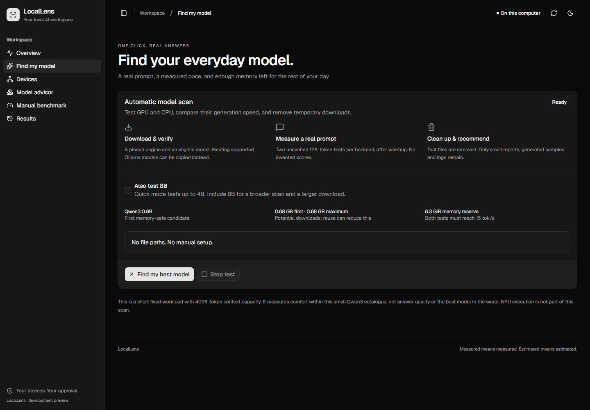

# LocalLens

**Local AI benchmarking for Windows.** Run real models on your PC, compare CPU and GPU throughput, and test compatible models on an Intel NPU. LocalLens keeps the measurements on your machine and uses them to recommend a comfortable model from its automatic test catalogue.



## Example measurements

One Windows 11 laptop with an Intel Core Ultra 7 155H, integrated Intel Arc graphics and 32 GB RAM. These are average generation rates from the same automatic scan, using llama.cpp b11900 and two 128-token measurements per backend.

| Model | Intel Arc Vulkan | CPU | Comfort result |
| --- | ---: | ---: | --- |
| Qwen3 4B Q4_K_M | 21.08 tok/s | 9.39 tok/s | Arc passed |
| Qwen3 8B Q4_K_M | 11.48 tok/s | 5.99 tok/s | Both below target |

Arc generated about 2.2 times as fast as the CPU on 4B. The 8B model ran on both backends, but neither reached the 15 tok/s comfort target. These results describe one machine and one workload. [CPU/GPU methodology and measured samples](docs/benchmark-results.md)

On the same laptop, the installed OpenVINO benchmark ran **Qwen3 0.6B INT4** on **Intel AI Boost** at **12.53 tok/s** and **1.38 s to first token** across three measured prompts. The NPU test used a different model and protocol, so these numbers are separate from the CPU/GPU comparison above.

## Try LocalLens

- **Current Windows desktop source.** [Build LocalLens with Tauri](desktop/README.md). The installer can bundle Python and OpenVINO GenAI. Use the NPU build option to include the Intel runtime.
- **Earlier downloadable preview.** The [0.2.0 ZIP](https://github.com/Falih2007/LocalLens/releases/tag/v0.2.0-preview.1) runs CPU/GPU tests on Windows x64 with Python 3.11+. Extract it and double-click **Start-LocalLens.cmd**.

Choose **Run a Benchmark** to test CPU and GPU with the automatic catalogue.
To test only the NPU on a fresh install, choose **Scan & Predict**, then open
**Manual benchmark**. Check the OpenVINO runtime and choose a trusted local
OpenVINO model folder. Onboarding is a one-time step. Reopen the
app to see saved results, or select **Test modes** to run another test.

### Run from source

Use Node.js 22.12+ to build the frontend, then launch with Python:

```powershell
cd frontend
npm ci
npm run build
cd ..
python app.py
```

## Benchmark modes

| Mode | What it measures |
| --- | --- |
| Automatic CPU/GPU | Real Qwen3 prompt tests, generation speed, and memory headroom. A recommendation requires passing the speed and memory targets. |
| Manual CPU/GPU | Separate prompt and generation measurements using your llama-bench build and a local GGUF model. |
| Manual Intel NPU | OpenVINO GenAI throughput and time to first token from a compatible exported model, targeting the NPU explicitly. |
| Scan & Predict | Hardware detection and estimated RAM fit. It runs no model. |

Results are saved locally in the benchmark journal and can be exported as JSON. Compare scores from the same model and protocol. The automatic scan downloads verified test files, may reuse a verified local model, and cleans up its temporary files. Use trusted engines and models because they run with your user permissions.

## Experimental device pairing

LocalLens can discover and pair with an optional Android companion on trusted private Wi-Fi. Pairing provides device information and connection tests. Phone compute is disabled in this preview. [Device pairing guide](CONNECT-DEVICES.md)

[Benchmark methodology](docs/benchmark-methodology.md) | [Development](docs/FRONTEND.md) | [Test evidence](docs/TESTING.md) | [Preview notes](docs/release-notes.md)
